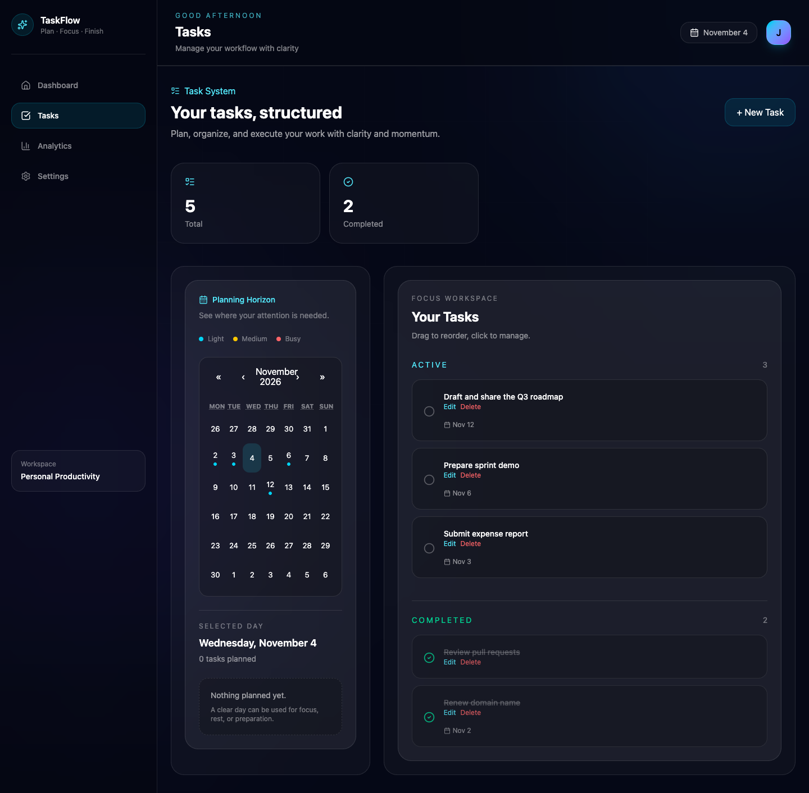
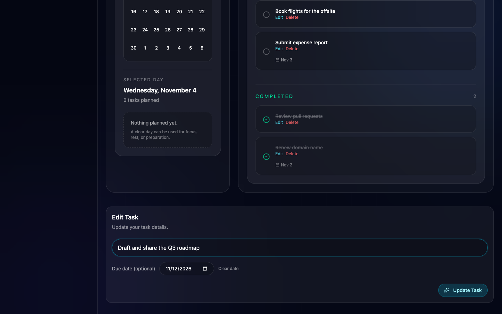
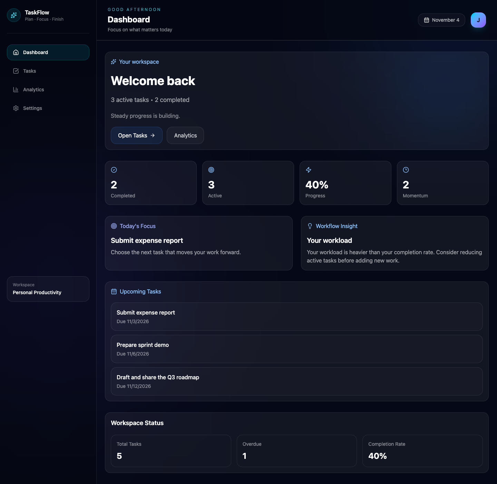
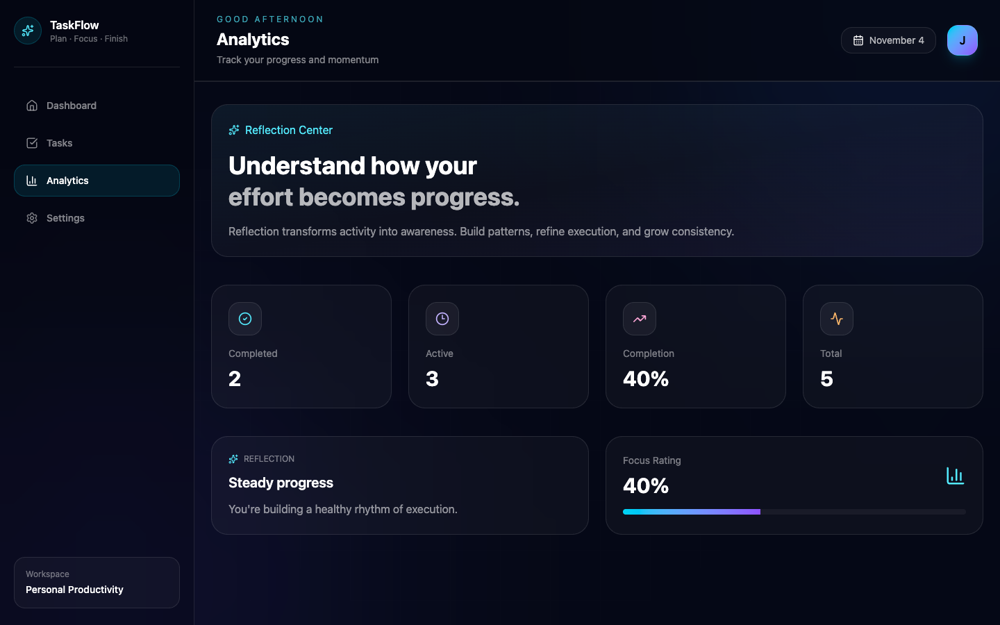
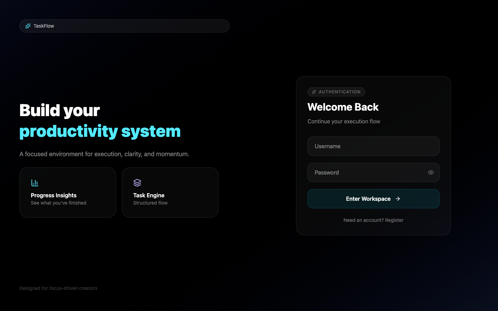
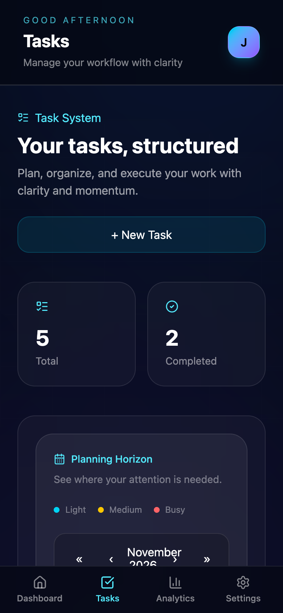
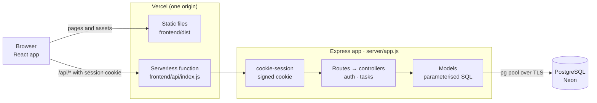

<h1 align="center">TaskFlow</h1>

<p align="center">
  <strong>Plan it. Focus. Finish it.</strong><br>
  A focused full-stack task manager: capture your work, check it off, and see your progress, with every task saved to your own account.
</p>

<p align="center">
  <a href="https://taskflow-zeta-ivory.vercel.app/"><strong>▶ Try the live app</strong></a>
  &nbsp;·&nbsp;
  <a href="#getting-started">Run it locally</a>
  &nbsp;·&nbsp;
  <a href="#api">API</a>
</p>

<p align="center">
  
  
  
  
  
  
</p>



## Overview

**What it is.** TaskFlow is a personal task manager with a calm, dark workspace. You sign up, add tasks, tick them off as you go, and get a running picture of how much you've finished.

**The problem it solves.** Most to-do apps either do too little (a list that forgets you when the tab closes) or too much (projects, labels and settings before you've written your first task). TaskFlow keeps to the essentials and makes them dependable: your tasks are stored in PostgreSQL, tied to your account, and still there tomorrow.

**Who it's for.** Students, developers and anyone who wants a simple, private list of what to do next, without setting up a full project-management tool.

**What makes it pleasant to use.**
- Changes appear instantly, then settle on what the server actually saved; if a save fails, the screen rolls back and tells you why.
- Your session survives page refreshes, so you stay in your workspace until you log out.
- The Dashboard and Analytics pages turn your list into a quick read on progress.

## Screenshots

<table>
  <tr>
    <td width="50%"></td>
    <td width="50%"></td>
  </tr>
  <tr>
    <td><em>Edit a task's title and due date; changes save straight to the database.</em></td>
    <td><em>Dashboard: where your work stands, computed from your tasks.</em></td>
  </tr>
  <tr>
    <td width="50%"></td>
    <td width="50%"></td>
  </tr>
  <tr>
    <td><em>Analytics: completion stats and a short reflection.</em></td>
    <td><em>Sign in or create an account.</em></td>
  </tr>
</table>

<p align="center">
  <br>
  <em>On phones, a bottom navigation bar replaces the sidebar.</em>
</p>

## Features

| | |
| --- | --- |
| **Accounts** | Register and log in with a username and password. New usernames are 3–30 characters and unique regardless of capitalisation; passwords need at least 8 characters and are hashed with bcrypt. |
| **Persistent sessions** | A signed, HTTP-only session cookie keeps you signed in across refreshes until you log out. |
| **Task management** | Create tasks, edit their titles, mark them complete or reopen them, and delete them. |
| **Due dates** | Give a task an optional due date, change it or clear it. Dates always show on the right calendar day, whatever your time zone. |
| **Private by default** | Every task belongs to one user; the API rejects reading or changing anyone else's. |
| **Active and Completed views** | Open work and finished work are listed separately, newest first. |
| **Dashboard** | Completed and active counts, progress percentage, overdue tasks (due before today) and upcoming tasks. |
| **Analytics** | Completion rate, totals and a reflection message based on your progress. |
| **Calendar** | Marks the days that have tasks due and lists the tasks due on the day you select. |
| **Works on phones** | A bottom navigation bar replaces the sidebar on small screens. |
| **Preferences** | Focus Mode dims the sidebar; Workflow insights shows a note about your workload on the Dashboard. Both are saved in your browser. |
| **Clear error feedback** | A failed save keeps your text and shows the reason; a failed complete or delete shows a notice and leaves your list on screen. |

## Tech stack

| Category | Technologies |
| --- | --- |
| **Frontend** | React 18, Vite 5, React Router 7, Tailwind CSS 4, Framer Motion, lucide-react, react-calendar |
| **Backend** | Node.js 20+, Express 4, express-rate-limit, cors (allow-listed origins only), dotenv |
| **Database** | PostgreSQL (Neon in production), node-postgres (`pg`) connection pool |
| **Authentication & security** | bcrypt, cookie-session (signed, HTTP-only, `SameSite=Lax`, `Secure` in production), ownership checks, sanitised error logging |
| **Deployment & infrastructure** | Vercel (static frontend and a serverless API function in one project), Neon serverless PostgreSQL |
| **Development & testing** | nodemon, Vite dev proxy, Node.js test runner, pg-mem, Vitest, Testing Library, jsdom, GitHub Actions CI |

## Architecture

TaskFlow is two applications in one repository: a React single-page app in `frontend/` and an Express API in `server/`. The API is defined once in `server/app.js` and runs two ways:

- **In production,** `frontend/api/index.js` exports the Express app as a Vercel serverless function, and `frontend/vercel.json` sends `/api/*` to it and every other path to the React app. Because the page and the API share one origin, the session cookie works without cross-site cookie settings or CORS.
- **Locally,** `server/index.js` runs the same app on port 8080, and Vite's dev server proxies `/api` to it.



**Request flow:** the browser calls `/api/...` with its session cookie → `cookie-session` verifies the cookie's signature and exposes `req.session.user_id` → an authentication check guards the task routes → the controller validates input and ownership → the model runs a parameterised query → the API returns JSON that the React hooks merge into the screen.

**Data model** ([`server/db/schema.sql`](server/db/schema.sql)): two tables. A user has many tasks, and deleting a user deletes their tasks.

| Table | Columns |
| --- | --- |
| `users` | `id`, `username` (unique), `password_hash` |
| `tasks` | `id`, `user_id` → `users.id`, `title`, `is_complete`, `due_date` |

## API

All responses are JSON. Task routes need a signed-in session, and users can only see and change their own tasks. The API returns ids as `user_id` and `task_id`.

### Authentication

| Method | Endpoint | Body | Success response |
| --- | --- | --- | --- |
| `POST` | `/api/auth/register` | `{ username, password }` | `201` `{ user: { user_id, username } }` |
| `POST` | `/api/auth/login` | `{ username, password }` | `200` `{ user: { user_id, username } }` |
| `GET` | `/api/auth/me` | — | `200` `{ user }`, or `401` when signed out |
| `DELETE` | `/api/auth/logout` | — | `200` `{ message }` |

### Tasks

| Method | Endpoint | Body | Success response |
| --- | --- | --- | --- |
| `GET` | `/api/tasks` | — | `200` `[task]`, newest first |
| `POST` | `/api/tasks` | `{ title, due_date? }` (date as `YYYY-MM-DD`) | `201` `task` |
| `PATCH` | `/api/tasks/:task_id` | `{ title?, is_complete?, due_date? }`; only the fields sent change, and `due_date: null` clears the date | `200` updated `task` |
| `DELETE` | `/api/tasks/:task_id` | — | `200` deleted `task` |

```json
{
  "task_id": 12,
  "user_id": 3,
  "title": "Draft and share the Q3 roadmap",
  "is_complete": false,
  "due_date": null
}
```

**Errors** come back as `{ error }` or `{ message }`: `400` for invalid input (such as an empty or over-200-character title, an invalid date, or an update with no fields), `401` when not signed in, `403` for another user's task, `404` for a task that doesn't exist, `429` after too many login or registration attempts, and `500` with a generic message for anything unexpected.

## Getting started

### Prerequisites

- Node.js 20 or later
- PostgreSQL
- npm

### 1. Clone and install

```bash
git clone https://github.com/iamtati1/taskflow.git
cd taskflow
cd server && npm install
cd ../frontend && npm install
```

The client and server have separate `package.json` files.

### 2. Configure the server

Create a local database and copy the environment template:

```bash
createdb taskflow
cp server/.env.template server/.env
```

Edit `server/.env`. Set either `DATABASE_URL` or the `PGHOST`/`PGPORT`/`PGDATABASE`/`PGUSER`/`PGPASSWORD` variables, plus a session secret:

```env
DATABASE_URL=postgresql://YOUR_USER@localhost:5432/taskflow
SESSION_SECRET=replace-with-a-long-random-string
```

Generate a secret with `openssl rand -hex 32`. The server refuses to start in production without one.

### 3. Create the tables

```bash
cd server
npm run db:setup
```

This runs `server/db/schema.sql`, which only creates tables that don't already exist. It never drops or changes existing tables or data.

### 4. Run the app

In one terminal, start the API on http://localhost:8080:

```bash
cd server
npm run dev
```

In a second terminal, start the client:

```bash
cd frontend
npm run dev
```

Open http://localhost:5173 and register an account. Vite proxies `/api` requests to the Express server.

### Deploying to Vercel

Create a Vercel project with **Root Directory** set to `frontend`. `frontend/vercel.json` installs the server's dependencies so the function can load `server/app.js`. Add these environment variables for each environment you deploy (Production and Preview):

| Variable | Purpose |
| --- | --- |
| `DATABASE_URL` | PostgreSQL connection string (Vercel doesn't provide a database) |
| `SESSION_SECRET` | Long random string that signs session cookies |

Environment-variable changes take effect on the next deployment.

## Testing

```bash
cd server && npm test
cd ../frontend && npm test
```

- **Server** (`node --test`): API tests run the real Express app against an in-memory PostgreSQL (pg-mem) built from the production schema. They cover registration rules, login, session restore and logout; creating, editing, completing and deleting tasks; due dates; ownership and error responses; and a check that existing records are never modified. Unit tests cover the user model, the login rate limiter, session-secret validation and log sanitising.
- **Frontend** (`vitest`): component and page tests for the task list, editor, Settings, sign-in page, mobile navigation and date handling. They check that edits and due dates save, that failed actions show an error without blanking the page, that buttons inside draggable task cards still receive clicks, and that dates land on the right day in any time zone.

GitHub Actions runs both suites and the production build on every push to `main` and every pull request.

Build the production frontend with `cd frontend && npm run build`.

## Engineering decisions

- **One Express app, two runtimes.** The API lives in `server/app.js` with no `listen()` call, so the same routes and middleware run locally and as a Vercel serverless function.
- **Same-origin deployment.** Serving the API from the frontend's own domain replaced a cross-origin setup that failed with CORS errors and would have needed cross-site cookie settings. Now the session cookie is first-party, with no CORS configuration in production.
- **Working with the production schema as it is.** The database uses `id` columns; the models alias them to `user_id` and `task_id` for the API, so existing users and tasks kept working without a data migration.
- **Ownership enforced twice.** Controllers check that a task belongs to the signed-in user, and the `UPDATE` and `DELETE` statements are also scoped by `user_id`.
- **Instant updates that settle on the truth.** The UI applies changes at once, rolls back if the request fails, and on success shows the task exactly as the server saved it.
- **Safe errors and logs.** Clients get generic messages for server errors; logs record an error category and code but never request bodies, passwords or database connection details.
- **Dates as calendar days.** Due dates travel as plain `YYYY-MM-DD` text from the database to the browser, which reads them as local days. Converting them to timestamps on the way would shift a task due on the 20th to the 19th for anyone in the Americas.
- **Guarding sign-in.** Login and registration share a rate limit (20 attempts per IP per 15 minutes, with a friendly `429`), and new accounts must meet username and password rules. On Vercel each function instance keeps its own count, so the limit slows guessing rather than enforcing a global cap.
- **Non-destructive database setup.** `npm run db:setup` uses `CREATE TABLE IF NOT EXISTS`, so it is safe to run against a database that already holds data.

## Roadmap

Not built yet:

- [ ] Saving the order of tasks after drag-to-reorder (needs a new database column)
- [ ] Task notes and priorities (needs new database columns)
- [ ] Colour themes
- [ ] Password reset and account settings
- [ ] A shared rate-limit store, so the login limit holds across serverless instances

---

<p align="center">Built by <a href="https://github.com/iamtati1">Tatiana Barmer</a></p>
