<h1 align="center">TaskFlow</h1>

<p align="center">
  <strong>Plan it. Focus. Finish it.</strong>
</p>

<p align="center">
  A calm, full-stack task manager with a calendar built around your day:<br>
  what's due, when it's happening, and what you need to remember when you get there.
</p>

<p align="center">
  <a href="https://taskflow-zeta-ivory.vercel.app/"><strong>Open the live app</strong></a>
  &nbsp;&nbsp;·&nbsp;&nbsp;
  <a href="#run-it-locally">Run it locally</a>
  &nbsp;&nbsp;·&nbsp;&nbsp;
  <a href="#built-with">Built with</a>
</p>

<br>

<p align="center">
  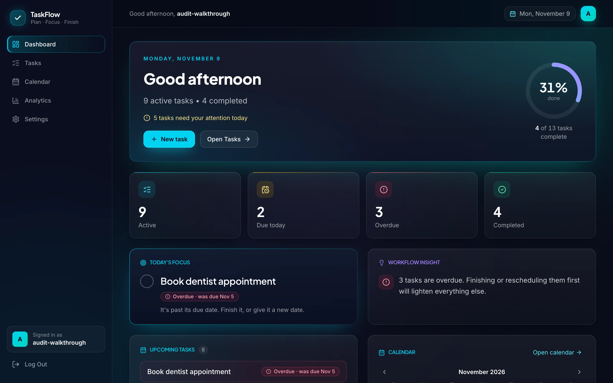
</p>

<br>

## Why TaskFlow

Most to-do apps fall into one of two traps. Some are a list that forgets everything when the tab closes. Others ask you to set up projects, labels and workflows before you've written your first task.

TaskFlow sits in between. It keeps to the essentials (tasks, due dates, a time when it matters, a note for context) and puts care into making them dependable and pleasant to use. Your work is saved to your own account, every change appears instantly, and the interface tells you plainly when something needs your attention.

I built it as a complete product rather than a demo: real accounts, a real database, a deployed app, and the small decisions that make software feel finished.

<br>

## A calendar that knows what time it is

<p align="center">
  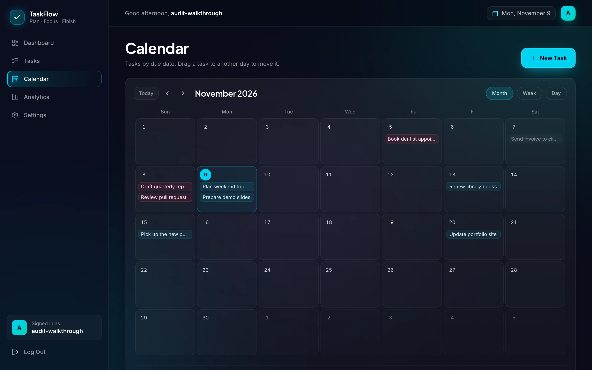
</p>

Tasks live on the days they're due. Switch between **Month**, **Week** and **Day** without losing your place, and the address bar keeps the view and day, so a refresh, the Back button or a shared link lands exactly where you were.

<table>
  <tr>
    <td width="50%" valign="top">
      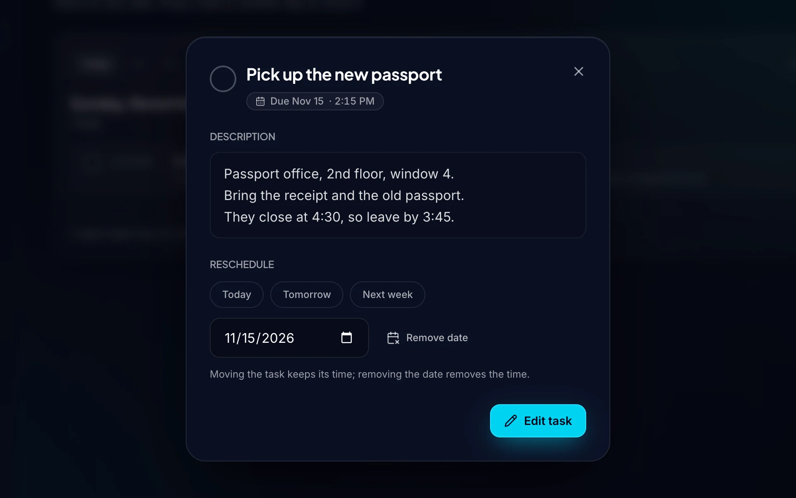
    </td>
    <td width="50%" valign="top">
      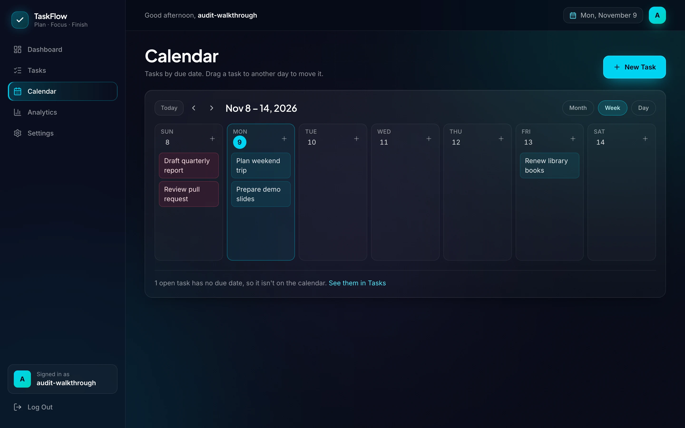
    </td>
  </tr>
  <tr>
    <td valign="top">
      <strong>Every task opens to its details.</strong> The description, the due date and time, and one-tap rescheduling (Today, Tomorrow, Next week or any date) without opening an editor.
    </td>
    <td valign="top">
      <strong>A week at a glance.</strong> Each day lists its tasks in the order you'll meet them. Drag a task to another day to move it; its time comes along.
    </td>
  </tr>
</table>

<p align="center">
  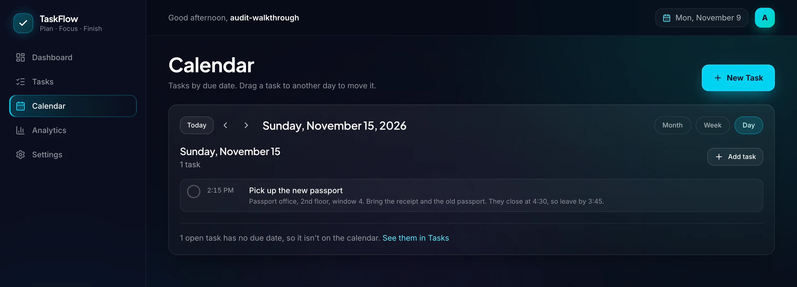
</p>

- **Scheduled times.** Give a task a time and it shows on the calendar, in its details and in the order of its day. Tasks without one stay simple deadlines.
- **Descriptions.** Add the context you'll need later: an address, a checklist, what to bring. It's previewed in the day's list and shown in full in the details.
- **Rescheduling that stays out of your way.** Drag on a desktop, or tap through from the details sheet on a phone or with a keyboard. Moving a task keeps its time; removing the date removes the time.
- **Nothing slips through.** Overdue tasks are tinted, finished ones are struck through, and the calendar tells you when open tasks have no date at all.

<br>

## Everything around it

<table>
  <tr>
    <td width="50%" valign="top">
      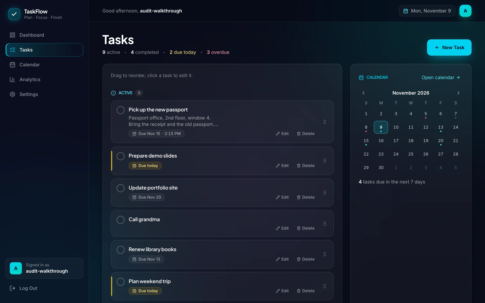
      <p><strong>Tasks.</strong> Your open and finished work, with due chips, description previews and a compact calendar beside the list. Every change appears instantly and settles on what was saved.</p>
    </td>
    <td width="50%" valign="top">
      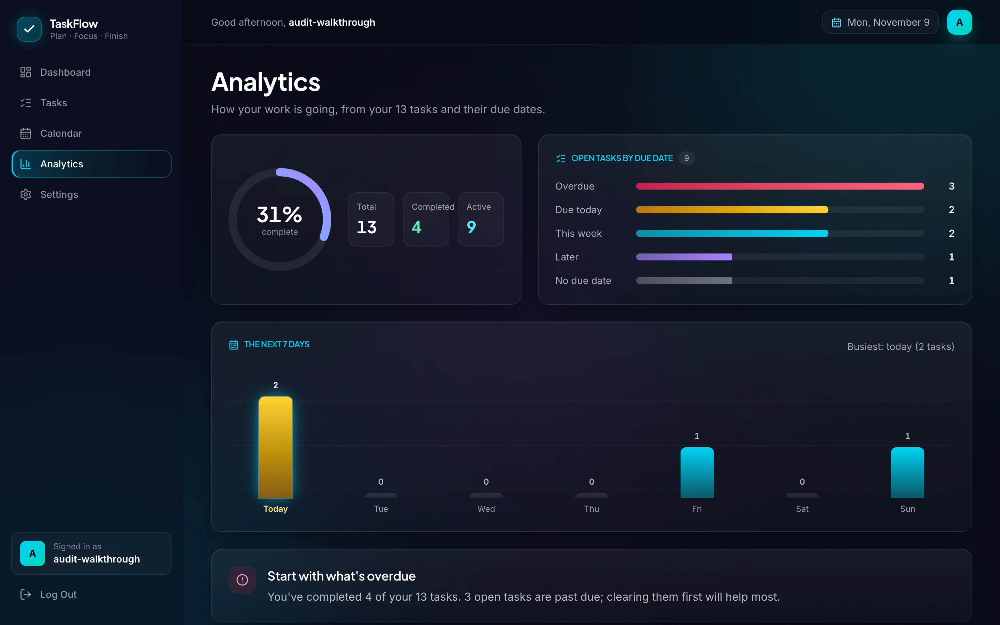
      <p><strong>Analytics.</strong> How your work is going: completion, open tasks by urgency, the week ahead, and a suggestion for where to start.</p>
    </td>
  </tr>
  <tr>
    <td width="50%" valign="top">
      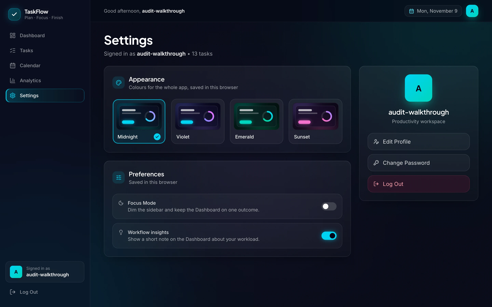
      <p><strong>Settings.</strong> Four colour themes, Focus Mode, workflow insights, and your username and password.</p>
    </td>
    <td width="50%" valign="top">
      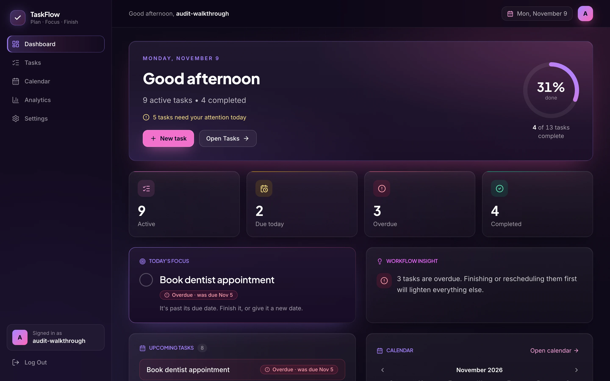
      <p><strong>Themes.</strong> Every accent in the app follows your choice, and it's applied before the first paint, so nothing flashes.</p>
    </td>
  </tr>
</table>

<table>
  <tr>
    <td width="25%"><strong>Dashboard</strong></td>
    <td>Where your day stands: progress, what's due today, what's overdue, one task to focus on, and what's coming up.</td>
  </tr>
  <tr>
    <td><strong>Accounts</strong></td>
    <td>Sign up and sign in with a username and password. Sessions survive a refresh, and every task is private to its owner.</td>
  </tr>
  <tr>
    <td><strong>Clear feedback</strong></td>
    <td>If a save fails, the screen rolls back, keeps what you typed and tells you why.</td>
  </tr>
  <tr>
    <td><strong>Keyboard friendly</strong></td>
    <td>Arrow keys move between days, dialogs keep and return focus, and every control has a label.</td>
  </tr>
</table>

<br>

## Designed for phones, too

<table>
  <tr>
    <td width="33%">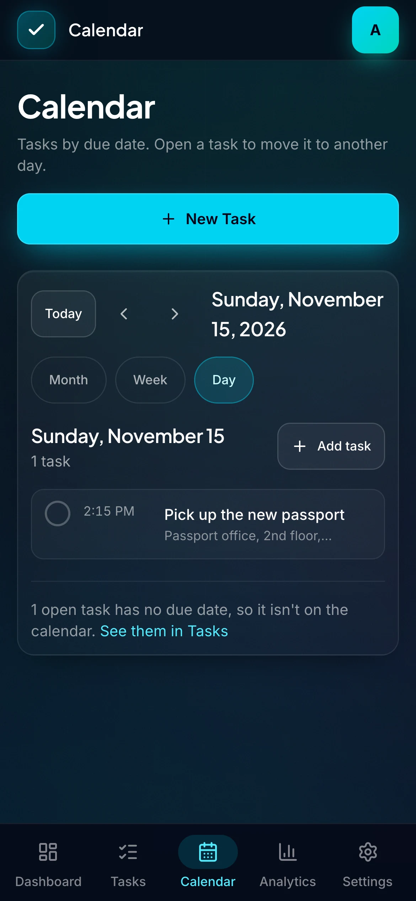</td>
    <td width="33%">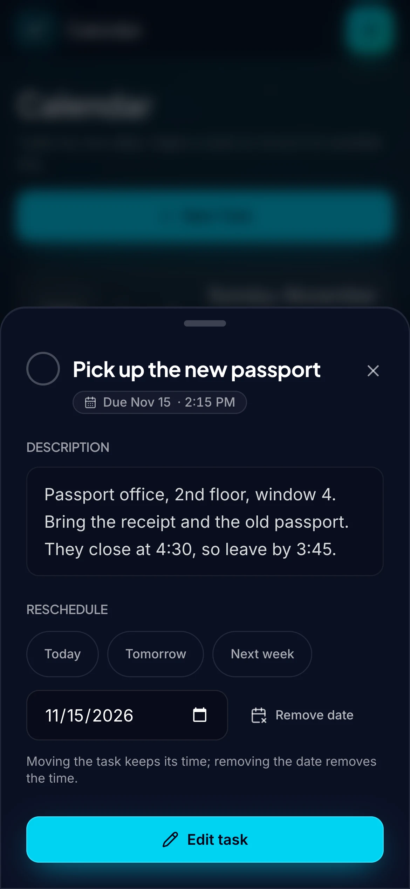</td>
    <td width="33%">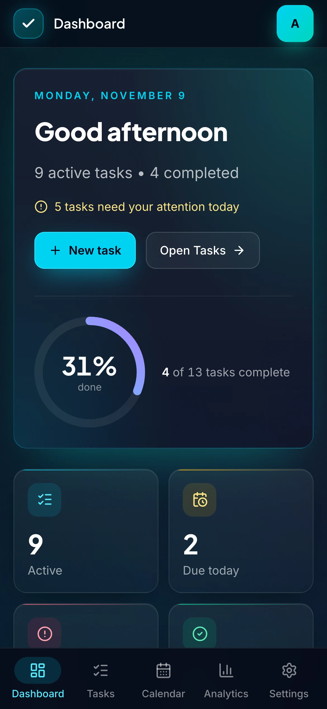</td>
  </tr>
</table>

On small screens the Calendar opens on the Day view, dialogs become bottom sheets, navigation moves to a bottom bar, and touch targets meet the 44-pixel guideline. Nothing scrolls sideways, even at 320 pixels wide.

<br>

## Built with

<table>
  <tr>
    <td width="25%"><strong>Frontend</strong></td>
    <td>React 18, React Router 7, Vite 5, Tailwind CSS 4, Framer Motion, lucide-react</td>
  </tr>
  <tr>
    <td><strong>Backend</strong></td>
    <td>Node.js 20+, Express 4, cookie-session, bcrypt, express-rate-limit</td>
  </tr>
  <tr>
    <td><strong>Database</strong></td>
    <td>PostgreSQL on Neon, node-postgres</td>
  </tr>
  <tr>
    <td><strong>Hosting</strong></td>
    <td>Vercel: the React app and the API as a serverless function, on one origin</td>
  </tr>
  <tr>
    <td><strong>Quality</strong></td>
    <td>Vitest and Testing Library, the Node.js test runner with pg-mem, GitHub Actions CI</td>
  </tr>
</table>

<br>

## What this project demonstrates

- **Full-stack product development.** A React single-page app and an Express API, designed together and shipped as one deployed product.
- **Database design and safe change.** A PostgreSQL schema for users and tasks, extended over time with additive, re-runnable migrations that never touch existing rows.
- **Authentication and privacy.** Hashed passwords, signed HTTP-only session cookies, rate-limited sign-in, and ownership checks on every task.
- **API design.** A small JSON API with input validation, consistent errors and partial updates.
- **Frontend engineering.** Instant, optimistic updates with rollback, a shared design system, themes driven by CSS variables, and a calendar built from scratch rather than from a widget library.
- **Responsive, accessible UX.** Layouts that work from 320 pixels up, keyboard navigation, labelled controls and colour contrast checked against WCAG AA.
- **Testing and validation.** More than 240 automated tests across the API and the interface, run on every push and pull request.

<details>
<summary><strong>A few decisions I'm glad I made</strong></summary>
<br>

- **Dates are calendar days, not timestamps.** A due date travels as plain `YYYY-MM-DD` from the database to the browser. Converting it to a timestamp would move a task due on the 20th to the 19th for anyone in the Americas. Scheduled times have no time zone for the same reason: 2:15 PM means 2:15 PM where you are.
- **Fast, but honest.** The interface updates immediately, then shows the task exactly as the server saved it, or puts it back and explains what went wrong.
- **One origin.** Serving the API from the app's own domain keeps the session cookie first-party, with no cross-site cookie settings to get wrong.
- **Schema changes that can't hurt.** Setup and migrations only add what's missing, so they're safe to run against a database already holding real users' data.

</details>

<br>

## Run it locally

You'll need **Node.js 20+**, **npm** and **PostgreSQL**.

**1. Install**

```bash
git clone https://github.com/iamtati1/taskflow.git
cd taskflow
cd server && npm install
cd ../frontend && npm install
```

**2. Configure the server**

```bash
createdb taskflow
cp server/.env.template server/.env
```

In `server/.env`, point the server at your database and set a session secret:

```env
DATABASE_URL=postgresql://YOUR_USER@localhost:5432/taskflow
SESSION_SECRET=replace-with-a-long-random-string
```

Generate a secret with `openssl rand -hex 32`. Instead of `DATABASE_URL`, you can set the standard `PGHOST`, `PGPORT`, `PGDATABASE`, `PGUSER` and `PGPASSWORD` variables.

**3. Create the tables**

```bash
cd server
npm run db:setup
```

This creates any missing tables and columns. It never drops or changes existing data.

**4. Start the API and the app**

In one terminal:

```bash
cd server
npm run dev
```

In another:

```bash
cd frontend
npm run dev
```

Open http://localhost:5173 and create an account. The app proxies `/api` to the server on port 8080.

**Tests and build**

```bash
cd server && npm test
cd ../frontend && npm test && npm run build
```

<details>
<summary><strong>Deploying to Vercel</strong></summary>
<br>

Create a Vercel project with its **Root Directory** set to `frontend`, and add two environment variables for Production and Preview:

| Variable | Purpose |
| --- | --- |
| `DATABASE_URL` | Your PostgreSQL connection string |
| `SESSION_SECRET` | A long random string that signs session cookies |

Run `npm run db:setup` against the database before the first deployment, and again after pulling changes that add columns.

</details>

<br>

## What's next

- [ ] Remember the order of tasks after drag-to-reorder
- [ ] Task priorities
- [ ] Password reset by email
- [ ] A shared rate-limit store, so the sign-in limit holds across serverless instances

Ideas and issues are welcome: open an issue to start a conversation.

<br>

---

<p align="center">
  Designed and built by <a href="https://github.com/iamtati1">Tatiana Barmer</a>
</p>
